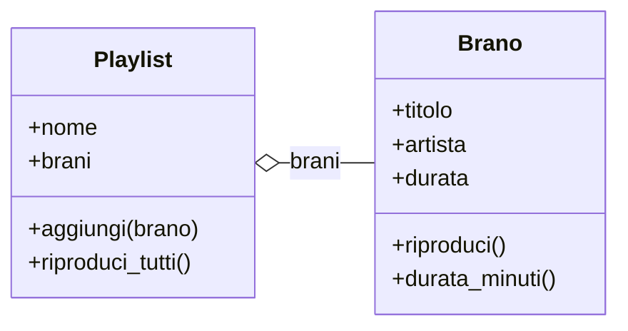
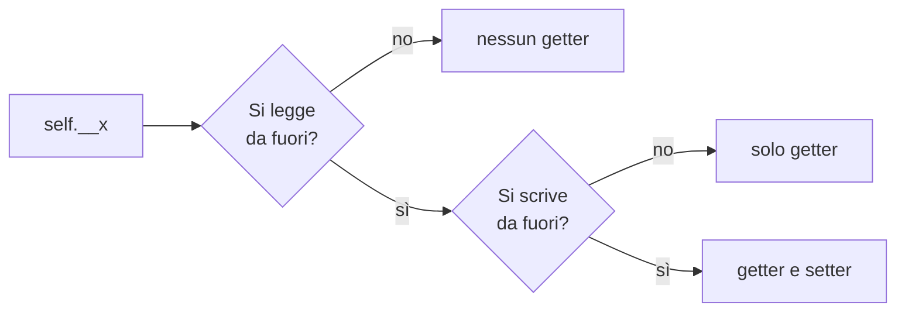
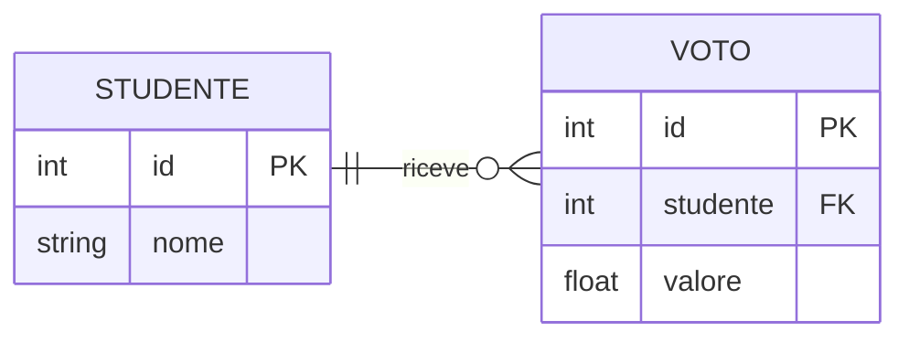

::title::

# Una playlist di brani

::default::

::caption::

Una `Playlist` tiene una lista di oggetti `Brano` e li riproduce uno per uno.

---
layout: default
kicker: Incapsulamento
---

# Getter, setter o niente?

---
layout: default
kicker: Tabelle e relazioni
volume: archivista
---

# Studenti e voti

Ogni studente riceve zero o più voti; ogni voto è di un solo studente.

